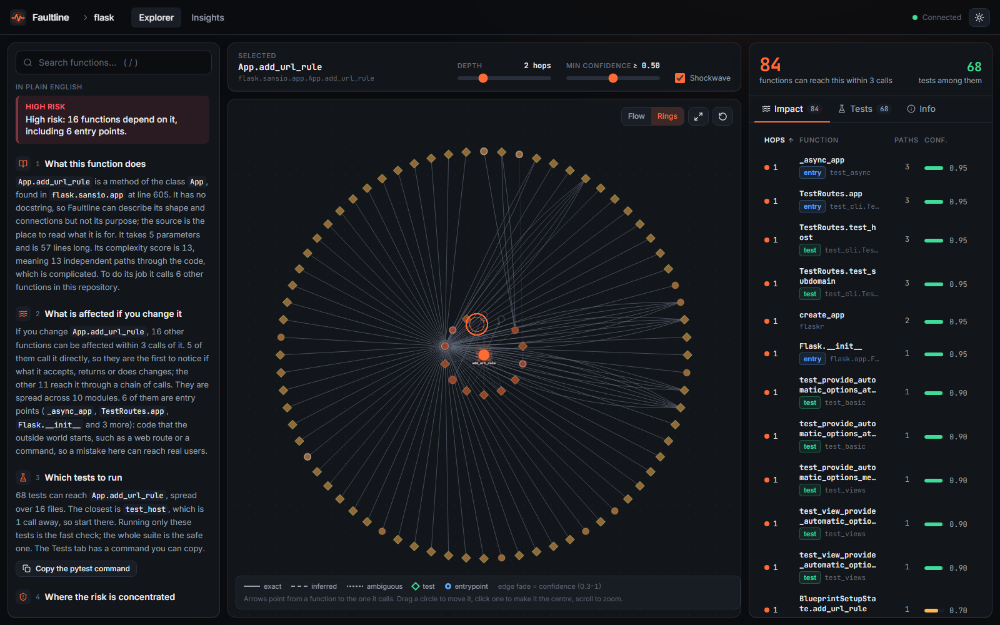
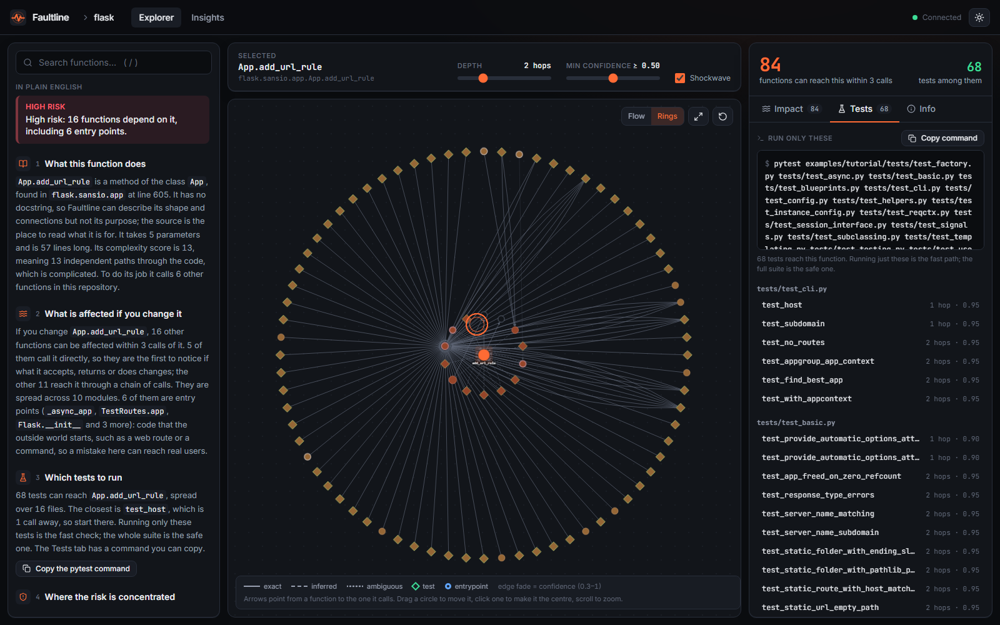
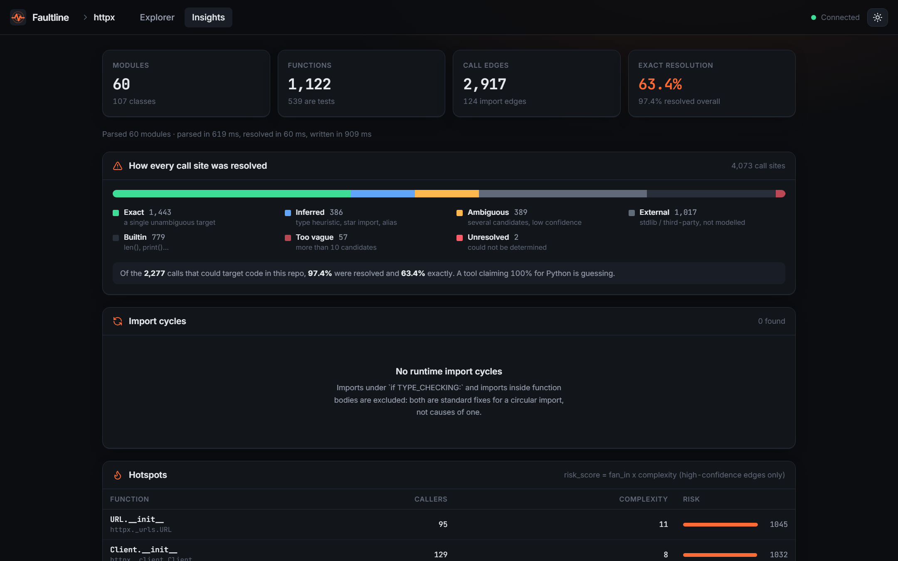

# Faultline

[](https://github.com/muzammilkhan2784/faultline/actions/workflows/ci.yml)

Faultline answers one question about Python code: **if I change this function, what could break, and which tests should I run?**

You give it a repo. It reads every function and who calls it, stores that as a graph in Neo4j, and shows it in a web app. Pick a function and you get the list of things that depend on it, the tests to run, and a short plain-English summary.



## What it does

- Finds every function and every call between them (static analysis, nothing is run).
- Shows what is affected if you change a function, and how far the change spreads.
- Gives a `pytest` command with only the tests that matter.
- Explains it in four short paragraphs: what the function does, what is affected, which tests to run, where the risk is.
- Flags risky code (many callers + complicated) and circular imports on an Insights page.

| Tests to run | Insights |
|---|---|
|  |  |

## Run it

Everything here is free. You need [Docker Desktop](https://www.docker.com/products/docker-desktop/) (free for personal use) and nothing else.

```bash
git clone https://github.com/muzammilkhan2784/faultline
cd faultline
docker compose up -d --build
```

Open http://localhost:5173 and click one of the example repos (like `pallets/flask`), or paste any public GitHub URL. API docs are at http://localhost:8000/docs. Stop it with `docker compose down`.

**Your own code:** push it to GitHub and paste the link, or copy the folder into `.repos/` and enter `/repos/your-folder`. Only Python (`.py`) files are read.

**No Docker?** The analyzer also works from the terminal with no database:

```bash
cd backend
pip install -e .
faultline analyze path/to/your/project
```

## How it works

1. **Parse** every `.py` file with Python's `ast` module.
2. **Resolve** each call to the function it points to, with a confidence score (an exact match is 1.0, a guess is lower).
3. **Store** functions and calls in Neo4j.
4. **Query** the graph to find everything that can reach a function.

The backend is FastAPI. The frontend is React, TypeScript and Cytoscape.

## Results

Measured on my laptop, not copied from anywhere:

| Repo | Lines of code | Time to analyze |
|---|---:|---:|
| Flask | 13,301 | 0.9 s |
| Django | 398,470 | 29.9 s |

- Impact queries on Django take about 4 ms (median).
- I labelled 142 calls by hand and checked Faultline against them. It matched all of them, and CI fails if that drops. It is a small sample, so treat it as a sanity check, not a guarantee.
- 846 tests, plus linting and strict type checks, run on every push.

## Known limits

- Python only.
- It reads code, it does not run it. Calls made through `getattr`, plugins or pytest fixtures can be missed.
- "Dead code" is only a list of candidates, never a promise.

More detail: [technical details](docs/DETAILS.md) · [design decisions](docs/DECISIONS.md) · [accuracy check](docs/ACCURACY.md)

MIT licensed. Built by Muzammilkhan Pathan.
